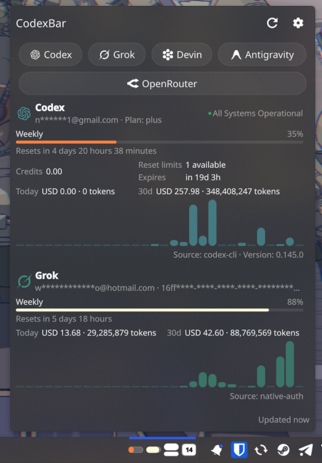

# codexbar-plasmoid



This repository provides a Plasma 6 widget for the [CodexBar](https://github.com/steipete/CodexBar) CLI.
The plasmoid shells out to the CLI instead of duplicating provider logic, then renders usage limits,
credits, status, local token costs, and recent history with native Plasma/Kirigami controls.

Package ID: `org.slopfire.codexbar-plasmoid` · License: MIT · Plasma: 6.0+

## Requirements

- KDE Plasma 6
- Node.js on `PATH` (helper scripts use `#!/usr/bin/env node`)
- CodexBar CLI on `PATH`, **or** enable **Auto-download from GitHub** in widget settings
- Optional: `cargo` only if you rebuild the bundled Linux helper from source

## Install

From this repository:

```sh
./scripts/install-plasmoid.sh
```

The install script builds the bundled Linux helper, removes older package IDs if present, then installs or upgrades the widget with `kpackagetool6`.

From a release archive (`.plasmoid`):

```sh
kpackagetool6 --type Plasma/Applet --install codexbar-plasmoid-v0.1.11-plasma6.plasmoid
# or upgrade:
kpackagetool6 --type Plasma/Applet --upgrade codexbar-plasmoid-v0.1.11-plasma6.plasmoid
```

Then add **CodexBar** from the Plasma widget explorer (System Information).

For local preview without installing:

```sh
./scripts/run-windowed.sh --allow-host-window
```

Agent / CI-style checks (virtual KWin, no host desktop interruption):

```sh
./scripts/agent-check.sh
./scripts/run-config-smoke.sh
```

## Package for release

Build a store-ready archive (includes the native helper, validates with `kpackagetool6`):

```sh
./scripts/package-plasmoid.sh
```

To increment the patch version, synchronize the Plasma/Rust metadata, update the
README and changelog, package and validate the archive, and create a scoped
release commit, run this from a clean Git working tree:

```sh
./scripts/package-plasmoid.sh --bump
```

Output lands in `dist/codexbar-plasmoid-v<version>-plasma6.plasmoid`. Upload with a
local signed-in Chrome session (cookies stay on the machine; nothing secret is
committed):

```sh
./scripts/release-kde-store.sh
```

Or upload `dist/*.plasmoid` manually on
[store.kde.org](https://store.kde.org/p/2365275) under Plasma 6 applets, with
`assets/screenshot.png` as the listing screenshot. Agent release procedure:
`.agents/skills/codexbar-release/SKILL.md`.

## Automatic CLI Updates

The widget can download and keep the CodexBar CLI up to date from the upstream
[steipete/CodexBar](https://github.com/steipete/CodexBar) GitHub releases.
Enable **Auto-download from GitHub** in the widget settings. When enabled, the
helper installs a managed binary at:

```text
~/.local/share/codexbar-plasmoid/bin/codexbar
```

and checks GitHub for a newer release at most once every 24 hours. Updates are
atomic: the new tarball is downloaded, its SHA-256 checksum is verified, the
binary is tested
with `--version`, and only then is the managed copy replaced. If the download
or test fails, the previous managed binary is preserved.

On Linux the updater prefers the statically-linked musl release asset
(`linux-musl-x86_64` / `linux-musl-aarch64`), which runs on NixOS and other
non-FHS systems without `libcurl`, `libstdc++`, or `libsqlite3` at runtime. It
falls back to the glibc asset only for releases that do not ship a musl build;
in that case a non-FHS host needs `nix-ld` (NixOS) or those libraries present,
or you can install a compatible CodexBar CLI yourself and point the CLI path at
it.

You can also check or trigger an update manually from the widget's full view
using the CLI update status row at the bottom.

The updater installs the release asset for the current platform and
architecture (`linux-musl-x86_64`, `linux-musl-aarch64`, `macos-x86_64`,
`macos-arm64`) together with its `VERSION` file, which the CLI reads to report
its version. Leave the **CLI executable** setting as `codexbar` to use the
managed binary when auto-update is enabled, or set an absolute path to use your
own installation.

## Configure

Open the widget configuration from Plasma and adjust:

- CLI path
- enabled providers and each provider's source, account, and all-accounts mode
- explicit provider-setting read/write synchronization between widget instances
- refresh interval and CLI timeout
- shared provider refreshes between widget instances
- sync server for cross-device publishing and the remote provider source
- status, credits, cost, and history visibility
- compact representation metric

With no explicit provider list, the plasmoid discovers installed local agents from their executables and standard config
directories. If none are found, it falls back to Codex only. Providers can also be added manually from the widget settings.
Source selection is stored per provider because the CodexBar CLI does not support every source for every provider, and some
web-backed sources are macOS-only.

Provider rows are saved as a JSON list in the `providerConfigs` Plasma setting. Each row contains:

```json
{
  "provider": "codex",
  "source": "cli",
  "enabled": true,
  "account": "",
  "accountIndex": 0,
  "allAccounts": false
}
```

`source` can be `auto`, `cli`, `oauth`, `api`, `web`, or `native`, depending on the provider. On Linux, `auto` maps
native-capable providers to the bundled native fetcher where appropriate: Antigravity, Command Code, Cursor, Devin, Grok,
OpenCode, and OpenCode Go use `native`; Codex, Claude, Augment, Factory, JetBrains, Kiro, Windsurf, and similar local-agent providers use `cli`;
API providers such as Gemini, OpenAI, Groq, DeepSeek, OpenRouter, and ClinePass use `api`; Vertex AI uses `oauth`;
Manus, Amp, T3 Chat, and similar browser-session providers use `web`.

The account fields map to the CodexBar CLI account flags:

- `account`: passes `--account <value>`
- `accountIndex`: passes `--account-index <n>` when `account` is empty and the index is greater than `0`
- `allAccounts`: passes `--all-accounts`

The refresh interval defaults to 5 minutes and is clamped to 1 minute through 24 hours. The request timeout is clamped to 5 through 300 seconds.
Automatic refreshes are spread by ±15% so several widgets do not poll on the same boundary.
Matching provider refreshes are shared by default between widget instances. Widgets using the same CLI, provider, source,
account, and fetch options reuse a protected per-provider cache for one refresh interval, so several widgets do not run the
same CodexBar usage and cost checks repeatedly. Manual refresh bypasses an older cached result, while simultaneous manual
refreshes still collapse into one provider check. Presentation settings and provider-chip selections remain per widget.

A refresh that fails transiently keeps the last good limits on screen with a soft *retrying* note instead of a red error,
retries once when the failure arrived early (a busy Codex app-server socket, a 429, a reset connection), and then backs off
before asking again. Failures are cached only for that short cooldown, never for the whole usage or cost window, so a
provider that recovers is picked up on the next refresh. When Codex's `cli` source cannot answer, the widget falls back to
the `oauth` source, which reads the same limits from the ChatGPT backend independently.

Under **General → Reliability** you can tune that behaviour: **Retries per refresh** (default 2 attempts) bounds the extra
calls inside one refresh, **Failure backoff cap** (default 180 seconds) is the longest wait before a failing provider is
asked again — the wait starts at 30 seconds and doubles — and **Cost scan timeout** (default 300 seconds) is the background
worker's budget, which you raise for very large Codex histories. A provider's own `Retry-After` hint is honoured up to the
backoff cap.

Cost is a background scanner. A full Codex cost walk takes 60-120 seconds, so the render path never runs it: it serves the
cached figures (marking them stale if a scan is in flight) and a detached worker refreshes them. Codex cost is scanned
natively by the bundled Rust binary in seconds — the upstream CLI segfaults walking Codex history on Linux, so it is only
kept as a one-shot fallback when the native scan comes back empty or fails. The next refresh shows the
new numbers, and a manual refresh starts a rescan without blocking the popup. A provider whose limits are unavailable while
its local spend is known says so on the card instead of showing a bare cost panel.
Use **Sync Write** to publish the current provider order, enabled state, source, account selection, all-accounts mode, and API
keys. Use **Sync Read** in another widget to import that shared list. Synchronization only happens when either button is pressed;
provider colors, tray-bar choices, and selected provider chips remain local to each widget.
Compact mode can show either the provider icon or usage bars; usage bars can represent the default provider, the selected
providers, or all providers, and can be tinted by provider color, remaining-limit gradient (white→yellow→red), pace to reset (white when the budget comfortably outlasts the window, yellow when tight, red when it is projected to run dry before reset — CodexBar's own pace report when it has one, computed locally from the window length and reset time otherwise), or theme text color.
New widget instances default to all-provider usage bars with the first bar emphasized, theme-text tinting, and no metric text.

Popup usage bars mark the fraction of the limit window remaining with a rounded gap and a pace indicator.
Under **Appearance → Pace indicator**, choose the color for the indicator's percentage position, the current bar color,
the provider color, or the theme text color. **Gaps only** hides the indicator and uses a narrower gap.
The default is **Position color**. Bars without a known window length and reset time remain continuous.

Email addresses are anonymized by default before the helper returns data to QML. Disable **Anonymize emails** only if the
widget may display full account addresses.

### Sync Server (cross-device sharing)

The bundled Linux helper doubles as a small self-hosted sync server. Widgets on different machines publish
their locally fetched usage, and every widget can read the merged result — so devices without provider
credentials still show usage, and the same provider API is not hit once per device.

What the server does:

- Stores one snapshot per device id (data dir: `~/.local/share/codexbar-plasmoid/sync-server`)
- Merges read-side per (provider, account): the freshest non-error entry wins for limits, status,
  and metadata, because those are account-global
- Sums daily token/cost history across the devices that contributed the same provider+account,
  with per-device provenance (`remoteDevices`) in each merged entry. Publications are local scans,
  so overlapping synced session logs could double-count; the server never silently deduplicates them
- Unions per-day rate-limit reset annotations, computed on each publisher's own calendar
- Prunes snapshots older than 60 days

What stays on the devices:

- Credentials (cookies, OAuth tokens, API keys) never leave the publishing device. The helper
  publishes only its post-normalization, post-anonymization entries; failed fetches are never
  published, so a bad refresh cannot clobber a device's last good snapshot
- All fetching logic (CLI, native fetchers, local cost scans) still runs on whichever device has
  the credentials; the server only stores and merges results

Run it on an always-on machine (NAS, home server):

```sh
codexbar-plasmoid sync-server --bind 0.0.0.0 --port 8188 --token <secret>
# optional: --data-dir /var/lib/codexbar-sync  (snapshots/<device>.json + token file)
# print the effective token without starting the server:
codexbar-plasmoid sync-server --show-token [--data-dir ...]
# forget a renamed/reinstalled device:
#   curl -X DELETE -H "Authorization: Bearer <secret>" http://host:8188/v1/snapshot/<device>
```

A user-level systemd unit ships at `scripts/codexbar-sync-server.service`
(`--bind 127.0.0.1` by default):

```sh
./scripts/install-sync-server.sh          # build + install binary, unit, start
# or by hand, after scripts/build-native-cli.sh:
#   install -m 755 native-cli/target/release/codexbar-plasmoid \
#     ~/.local/share/codexbar-plasmoid/bin/codexbar-plasmoid
#   mkdir -p ~/.config/systemd/user
#   cp scripts/codexbar-sync-server.service ~/.config/systemd/user/
#   systemctl --user daemon-reload
#   systemctl --user enable --now codexbar-sync-server
```

The unit runs `~/.local/share/codexbar-plasmoid/bin/codexbar-plasmoid`, which is the
native-cli build (`codexbar-plasmoid sync-server …` in the block above is that
binary). The `bin/` dir also holds the managed upstream `codexbar` the widget
auto-updates; that binary has no `sync-server` command, so a unit pointed at it
exits with `Unknown command 'sync-server'`, and one pointed at a path that was
never installed fails with `status=203/EXEC` and restart-loops while every
widget shows `ECONNREFUSED` on the sync port.

Optionally put the token in `~/.config/codexbar-sync-server.env` as
`CODEXBAR_SYNC_TOKEN=<secret>` instead of leaving it in the data-dir token file.

Routes: `GET /health` (no token), `PUT /v1/snapshot/<device>` (publish), `DELETE /v1/snapshot/<device>` (forget a device, idempotent), `GET /v1/usage?provider=<id>`
(merged entries in the helper's JSON shape), `GET /v1/devices`. Every `/v1` route needs the bearer
token; without `--token` or `CODEXBAR_SYNC_TOKEN` the server generates one at `<data-dir>/token` and
never prints it (read it back with `sync-server --show-token`). Plain HTTP carries that token on every request — put the server behind a reverse
proxy or a Tailscale/WireGuard tunnel rather than exposing it directly.

History merging is dedup-aware: each local cost scan stamps its days with a
content fingerprint, so identical history published from two devices (a synced
`~/.codex`, the same Cursor dashboard page) is counted once instead of summed.
Distinct sessions still sum; Cursor-style cloud data takes the freshest copy.

Widget setup: under Configure → General → **Sync server**, set the base URL (`http://host:8188`,
optional token, optional device name; defaults to the hostname). Every successful refresh then
publishes this device's locally fetched entries, and provider rows (Providers page) can select the
new **Sync server** source to render the merged cross-device data instead of fetching locally —
the last-published entry per (provider, account) wins for limits, and daily cost/history rows are
summed across devices. This is an addition, not a replacement: without a configured sync server,
or for provider rows left on their usual sources, everything works exactly as before.

For a device that should not fetch any provider itself (no CLI, no credentials), turn on
**Sync all from the server** at the top of the Providers page. Every provider then renders the
server's merged cross-device state and the widget skips local fetching entirely — the CLI is never
invoked, no cost scan runs, and nothing is published back. The per-provider list grays out because
sources, accounts, and enabled flags no longer affect what is shown. The popup footer notes when it
is showing merged server state. Providers the server has never seen still appear as an explanatory
card rather than leaving a blank widget.

### Android client

`android/` is a Jetpack Compose app (Material 3 Expressive) that reads the same sync server, so a
phone can show the merged cross-device usage without holding any provider credentials:

- `GET /health`, `GET /v1/usage?provider=<id>`, `GET /v1/devices`, and an explicit
  `DELETE /v1/snapshot/<device>` behind the same bearer token
- Provider cards with remaining-limit bars and pace indicators, credits, reset credits, token cost,
  a tappable 30-day history chart with per-model breakdowns, and per-device provenance
- Material You dynamic color on Android 12+, `MotionScheme.expressive()`, the expressive shape
  scale, a short navigation bar, and the `MaterialShapes` cookie avatar for provider icons

```sh
cd android
./gradlew :app:assembleDebug        # APK at app/build/outputs/apk/debug/
./gradlew :app:testDebugUnitTest    # 69 JVM unit tests over parsing, HTTP and the repository
```

The app is plain HTTP + bearer token, so point it at the server over a LAN or a
Tailscale/WireGuard tunnel. See `android/README.md` for details.

### Environment Variables on Linux (esp. NixOS)

The plasmoid process inherits the user's session environment from `systemd --user`, which only sources
`$XDG_CONFIG_HOME/environment.d/*.conf`. Variables exported from `~/.zshrc`, `~/.bashrc`, or a nix profile are
**not** available to spawned children, so the upstream CodexBar CLI sees no API keys and the bundled native
binary cannot find `lsof` even when both exist on the shell's `PATH`.

Two opt-in sources are loaded by the helper **before** it spawns the upstream CLI or the native binary:

1. `$XDG_CONFIG_HOME/environment.d/*.conf` (default `~/.config/environment.d/*.conf`) — systemd-style `KEY=VAL` files,
   loaded in lexical order so later files override earlier ones. This is the right place to put `DEEPSEEK_API_KEY`,
   `OPENROUTER_API_KEY`, `NIX_LD_LIBRARY_PATH`, `PATH`, and any other env var the widget should see.
2. `~/.codexbar/.env` — a plasmoid-local dotenv. Its values win over `environment.d` (matching systemd's later-wins
   semantics), so it is a convenient place to override a system-wide key for this widget without touching the global
   env. The format is the same `KEY=VAL` per line; `#` comments and `export FOO=bar` prefixes are accepted, and
   surrounding single or double quotes are stripped.

Values that are already set in the plasmoid process's `process.env` (e.g. injected by systemd or Plasma) always
take precedence over anything loaded from disk.

Example NixOS setup that gets Antigravity, DeepSeek, and OpenRouter working without touching shell rc files:

```ini
# ~/.config/environment.d/codexbar.conf
PATH=/run/current-system/sw/bin:/etc/profiles/per-user/<user>/bin:/home/<user>/.nix-profile/bin:/run/wrappers/bin
NIX_LD_LIBRARY_PATH=/run/current-system/sw/share/nix-ld/lib
DEEPSEEK_API_KEY=sk-...
OPENROUTER_API_KEY=sk-or-v1-...
DEVIN_BEARER_TOKEN=devin-token...
DEVIN_ORGANIZATION=org_slug
```

Then log out and back in (or `systemctl --user import-environment`) so `systemd --user` picks up the new file.
The widget does not modify `PATH` or `NIX_LD_LIBRARY_PATH` itself — set them where the rest of your environment
lives.

### API Key Configuration

For providers that use the `api` source, the helper can inject API keys from either:

- Directly within the widget's settings for that provider
- `~/.codexbar/config.json`

The inline widget settings configuration wins when both exist. When using `~/.codexbar/config.json`, use a provider-keyed object:

```json
{
  "providers": {
    "gemini": { "apiKey": "..." },
    "openai": { "apiKey": "..." },
    "openrouter": { "apiKey": "..." }
  }
}
```

The helper converts `apiKey` into the environment variable expected by the CodexBar CLI when that variable is not already
set. Supported mappings include `GEMINI_API_KEY`, `OPENAI_API_KEY`, `OPENROUTER_API_KEY`, `GROQ_API_KEY`,
`DEEPSEEK_API_KEY`, `DOUBAO_API_KEY`, `MINIMAX_API_KEY`, `MOONSHOT_API_KEY`, `KILO_API_KEY`, `LLMPROXY_API_KEY`,
`SYNTHETIC_API_KEY`, `VENICE_API_KEY`, `ZAI_API_KEY`, `AZURE_OPENAI_API_KEY`, `ALIBABA_API_KEY`, `CLINE_API_KEY` for
ClinePass, `GITHUB_TOKEN` for Copilot, and `DEVIN_BEARER_TOKEN` for Devin (manual token auth; pair with `DEVIN_ORGANIZATION`).
The ClinePass CLI also accepts `CLINEPASS_API_KEY` when it is already present in the plasmoid environment.

The Plasma package ID is `org.slopfire.codexbar-plasmoid`. The release archive ships a prebuilt Linux helper for **x86_64** only; rebuild with `./scripts/build-native-cli.sh` on other architectures.

## CLI Contract

The widget uses:

```sh
codexbar usage --format json --json-only --provider <provider> --source <source>
codexbar cost --format json --json-only --provider <provider>
```

Provider status, credits, account selection, email anonymization, and local cost history are controlled through the
plasmoid settings and mapped to the corresponding CodexBar CLI flags. The helper calls `codexbar usage` once per
configured provider so each provider can use its own source mode. Cost lookup is best effort: a cost failure is displayed
as `costError` but does not discard successful usage data.

Usage bars show the percentage **remaining**. Local cost totals marked by the CLI
as `listPriceEstimate` are identified as list-price estimates, not billed charges.
Codex local token totals include cached input tokens and are separate from the
account's rate-limit percentage.
When the CLI reports incomplete local history, the card warns that totals may
omit usage. Manual refresh also passes `--refresh` to the CodexBar cost backend to
bypass its scan debounce, so another bounded scan can continue catching up; native
backends keep their existing arguments. Local history does not include remote
usage unless the corresponding logs are present on this computer.

## Linux Helper

Antigravity, CodeBuddy, Command Code, Cursor, Devin, Grok, OpenCode, and OpenCode Go need Linux-specific handling. This repository ships a Rust binary,
`codexbar-plasmoid`, bundled inside the plasmoid at `plasmoid/contents/code/codexbar-plasmoid`. It reads browser cookies
or `~/.codexbar/config.json` manual cookie headers and calls provider APIs directly where possible. Antigravity can either
probe a running `agy`/IDE language server locally, or use **Native Auth** (browser Google OAuth via
`codexbar-plasmoid login --provider antigravity`, or tokens from `antigravity-usage login`, stored under
`~/.config/antigravity-usage`) to call the Cloud Code API without the IDE.
Devin calls the `app.devin.ai/api/<org>/billing/quota/usage` endpoint with a Bearer token.
CodeBuddy calls `www.codebuddy.ai/billing/meter/{get-user-resource-summary,get-user-resource-free-packages}` with the
Bearer token that `codebuddy` sign-in writes to
`~/.local/share/CodeBuddyExtension/Data/Public/auth/Tencent-Cloud.coding-copilot.info` (overrides:
`CODEBUDDY_ACCESS_TOKEN`, `CODEBUDDY_AUTH_FILE`, `CODEBUDDY_API_BASE`). Every CodeBuddy allowance is a monthly credit
cycle, so each credit package becomes one usage row.
Command Code calls `api.commandcode.ai/alpha/{billing/credits,billing/subscriptions,whoami}` with the API key that
`cmd login` writes to `~/.commandcode/auth.json` (overrides: `COMMANDCODE_API_KEY`, `COMMANDCODE_AUTH_FILE`,
`COMMANDCODE_HOME`, `COMMANDCODE_API_BASE`). Its token spend is read from the local session transcripts under
`~/.commandcode/projects/**/*.jsonl`.

Build and bundle it:

```sh
./scripts/build-native-cli.sh
```

`./scripts/install-plasmoid.sh` and `./scripts/run-windowed.sh` build the binary automatically before installing or
previewing the widget.

Run it directly:

```sh
plasmoid/contents/code/codexbar-plasmoid usage --format json --json-only --provider cursor --source native
```

In widget settings, choose **Linux Helper** as the source for Antigravity, Command Code, Cursor, Devin, Grok, OpenCode, or OpenCode Go. Linux auto mode
already prefers Linux Helper for those providers. For Antigravity without a running IDE, choose **Native Auth** after browser login:

```sh
# Desktop OAuth app client is read from the local `agy` binary (not shipped in this repo).
# Optional override: ANTIGRAVITY_OAUTH_CLIENT_ID / ANTIGRAVITY_OAUTH_CLIENT_SECRET
plasmoid/contents/code/codexbar-plasmoid login --provider antigravity
plasmoid/contents/code/codexbar-plasmoid usage --format json --json-only --provider antigravity --source native-auth
```

`login` opens Google in your browser, captures the localhost redirect, and stores tokens under
`~/.config/antigravity-usage` (same layout as [`antigravity-usage`](https://www.npmjs.com/package/antigravity-usage)).
The OAuth *app* client id/secret are extracted from a local Antigravity `agy` install (PATH,
`~/.local/bin/agy`, or `CODEXBAR_ANTIGRAVITY_BINARY`) so they never need to live in this repository.
Use `--manual` to paste the redirect URL if the automatic callback fails. `logout --provider antigravity` removes stored
tokens (`--all` clears every account).

With Antigravity source set to **Linux Helper** (or Linux auto), the fetcher tries the local IDE first and falls back to Native
Auth tokens when the IDE is not running.

Authentication options:

- Antigravity **Linux Helper**: a running `agy` process or Antigravity IDE language server
- Antigravity **Native Auth**: browser OAuth via `codexbar-plasmoid login --provider antigravity` (or existing
  `antigravity-usage login` tokens) in `~/.config/antigravity-usage` (Cloud Code API; no IDE required). Login and token
  **refresh** use the Google OAuth *app* client extracted from the local `agy` binary (optional override:
  `ANTIGRAVITY_OAUTH_CLIENT_ID` / `ANTIGRAVITY_OAUTH_CLIENT_SECRET`, or `oauth_client_*` in `~/.codexbar/config.json`)
- `~/.codexbar/config.json` provider `cookie_header`
- `CODEXBAR_PLASMOID_CURSOR_COOKIE`, `CODEXBAR_PLASMOID_OPENCODE_COOKIE`, or `CODEXBAR_PLASMOID_OPENCODEGO_COOKIE` (or older `SPLAZMA_*` fallback)
- Chrome/Chromium/Helium/Firefox/Zen cookie import (`secret-tool` required for encrypted Chromium cookies)
- OpenCode Go subscription rate limits from an opencode.ai session (not estimated from local SQLite)
- OpenCode / OpenCode Go local token spend from `~/.local/share/opencode/*.db` (cost)
- Codex local token spend from `~/.codex/sessions` plus `archived_sessions` (`$CODEX_HOME` overrides the base dir; cost, scanned natively in seconds with one upstream attempt as fallback)
- Devin: `DEVIN_BEARER_TOKEN` (or `DEVIN_AUTHORIZATION`) env var, or `~/.codexbar/config.json` provider `cookie_header`; pair with `DEVIN_ORGANIZATION` (or `DEVIN_ORG`) for the org slug, internal `org_...` ID, or full `app.devin.ai/org/<slug>` URL
- CodeBuddy: `~/.local/share/CodeBuddyExtension/Data/Public/auth/Tencent-Cloud.coding-copilot.info` from `codebuddy` sign-in (or `CODEBUDDY_ACCESS_TOKEN`); monthly credit packages only, no token spend
- Command Code: `~/.commandcode/auth.json` from `cmd login` (or `COMMANDCODE_API_KEY`); Command Code token spend from `~/.commandcode/projects/**/*.jsonl` (cost)

Native cookie / auth configuration uses a provider list (local only — do not commit real secrets):

```json
{
  "providers": [
    {
      "id": "opencode",
      "cookie_header": "auth=...",
      "workspace_id": "wrk_..."
    },
    {
      "id": "cursor",
      "cookie_header": "WorkosCursorSessionToken=..."
    },
    {
      "id": "devin",
      "cookie_header": "eyJhbGci...",
      "workspace_id": "org/my-team"
    },
    {
      "id": "antigravity",
      "oauth_client_id": "<your-google-oauth-client-id>",
      "oauth_client_secret": "<your-google-oauth-client-secret>"
    }
  ]
}
```

Set `CODEXBAR_CONFIG=/path/to/config.json` to use a different native-fetcher config file. For OpenCode and OpenCode Go,
`workspace_id` can also come from `CODEXBAR_OPENCODE_WORKSPACE_ID` or `CODEXBAR_OPENCODEGO_WORKSPACE_ID`; the value may
be a raw `wrk_...` id or a URL containing one. For Devin, `workspace_id` holds the organization slug, internal `org_...` ID,
or full `app.devin.ai/org/<slug>` URL; it can also come from `DEVIN_ORGANIZATION` or `DEVIN_ORG`.

Successful Antigravity native fetches are cached under the user cache directory. If Antigravity is not running later, the
widget shows the last fetched Antigravity usage with a status note instead of replacing it with an error-only card.
